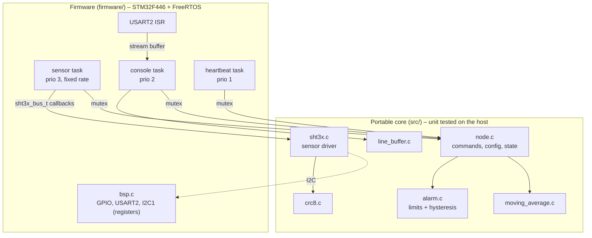

# stm32-sensor-node

[](https://github.com/<YOUR_GITHUB_USER>/stm32-sensor-node/actions/workflows/ci.yml)

Temperature / humidity sensor node on an **STM32F446RE (Cortex-M4F)** running
**FreeRTOS**. It samples a Sensirion **SHT3x** over I2C, filters the data,
monitors temperature limits with hysteresis, and offers a command console
over the ST-LINK virtual COM port.

The focus of this project is engineering quality rather than features:

- **Layered design**: all application logic is hardware- and RTOS-independent
  and runs unchanged on the PC.
- **Unit tests** for every portable module (Unity), run in CI with
  AddressSanitizer and UndefinedBehaviorSanitizer.
- **Static analysis** (cppcheck) and a strict warning set (`-Wall -Wextra
  -Werror -Wconversion -Wsign-conversion ...`) on every push.
- **Register-level drivers** written from the reference manual (RM0390), no
  vendor HAL, so every hardware access is explicit.
- **No dynamic memory** in application code, fixed-point arithmetic only,
  timeouts on every hardware wait.

<!-- Add a photo of your setup here:

-->

## Architecture



| Task      | Priority | Job                                                                   |
|-----------|----------|-----------------------------------------------------------------------|
| sensor    | 3        | Measures at a fixed rate (`xTaskDelayUntil`), filters, updates alarm  |
| console   | 2        | Receives bytes from the UART ISR via a stream buffer, runs commands   |
| heartbeat | 1        | LED blinks slowly when normal, fast when a temperature alarm is active|

Shared state (`node_t`) is protected by a mutex; UART output by a second mutex.
The SHT3x driver never touches hardware directly. It receives a small bus
interface (`write`, `read`, `delay_ms`), which is implemented by the I2C BSP on
the target and by a fake bus in the unit tests.

## Hardware

| Part                         | Notes                                   |
|------------------------------|-----------------------------------------|
| NUCLEO-F446RE                | any STM32F4 Nucleo works with small changes |
| SHT31 / SHT35 breakout       | I2C address 0x44 (ADDR pin low)         |
| 2 × 4.7 kΩ pull-ups          | if the breakout board doesn't have them |

| SHT3x | Nucleo pin         |
|-------|--------------------|
| VDD   | 3V3                |
| GND   | GND                |
| SCL   | D15 / PB8          |
| SDA   | D14 / PB9          |

Console: ST-LINK USB virtual COM port, **115200 8N1**.

## Building

Requirements: CMake ≥ 3.20, a host C compiler, and for the firmware the
GNU Arm Embedded toolchain (`gcc-arm-none-eabi`). FreeRTOS and Unity are
downloaded automatically by CMake.

### Unit tests (host)

```bash
cmake -B build-host -DENABLE_SANITIZERS=ON
cmake --build build-host
ctest --test-dir build-host --output-on-failure
```

### Firmware

```bash
cmake -B build-fw -DCMAKE_TOOLCHAIN_FILE=cmake/arm-none-eabi.cmake -DCMAKE_BUILD_TYPE=Release
cmake --build build-fw
```

Output: `build-fw/firmware/sensor_node.elf` and `sensor_node.bin`.

### Flashing

Either drag `sensor_node.bin` onto the Nucleo USB drive, or:

```bash
st-flash write build-fw/firmware/sensor_node.bin 0x08000000
# or
openocd -f board/st_nucleo_f4.cfg -c "program build-fw/firmware/sensor_node.elf verify reset exit"
```

## Usage

Open the serial port (e.g. `picocom -b 115200 /dev/ttyACM0`):

```
stm32-sensor-node ready. Type 'help'.
T=22.81C RH=41.37% ALARM=NORMAL
T=22.83C RH=41.35% ALARM=NORMAL
> rate 250
OK rate=250ms
> limits 15 25
OK limits=15..25C
> status
rate=250ms stream=on limits=15.00..25.00C samples=42 errors=0 alarm=NORMAL
> stream off
OK stream=off
> read
T=22.84C RH=41.30% ALARM=NORMAL
```

| Command                 | Description                                       |
|-------------------------|---------------------------------------------------|
| `help`                  | list commands                                     |
| `status`                | configuration and counters                        |
| `read`                  | latest filtered reading                           |
| `rate <ms>`             | sampling period, 100 … 60000 ms                   |
| `stream on\|off`        | print every measurement or stay quiet             |
| `limits <low> <high>`   | temperature alarm limits in °C (0.5 °C hysteresis)|

Alarm transitions are reported as `EVENT alarm=HIGH|LOW|NORMAL`.

## Design notes

- **Fixed point**: temperature and humidity are stored in 0.01 units
  (`int32_t`), so no floating-point formatting is needed and the conversion
  is exact and testable.
- **CRC check** on every sensor word; failed reads are counted and never
  enter the filter.
- **Hysteresis** prevents the alarm from toggling when the temperature sits
  right at a limit.
- **I2C robustness**: every flag wait has a timeout; on a stuck bus the
  peripheral is reset (`SWRST`) and the next measurement retries.
- **Interrupt priorities**: the UART ISR runs at priority 6, below
  `configMAX_SYSCALL_INTERRUPT_PRIORITY` (5), so it may use FreeRTOS
  `FromISR` APIs.
- **Stack overflow and malloc-failed hooks** are enabled and halt in
  `configASSERT` for the debugger.

## Project layout

```
src/            portable application core (no hardware, no RTOS)
test/           Unity unit tests for src/
firmware/       STM32F446 startup, linker script, BSP, FreeRTOS config, main
cmake/          ARM cross-compilation toolchain file
.github/        CI: unit tests + sanitizers, cppcheck, firmware build
```

## Possible extensions

- Run the core at 180 MHz from the PLL
- I2C via DMA instead of polling
- CAN output of measurements (bxCAN)
- Store limits in flash
- Hardware-in-the-loop test on a self-hosted runner

## License

MIT
